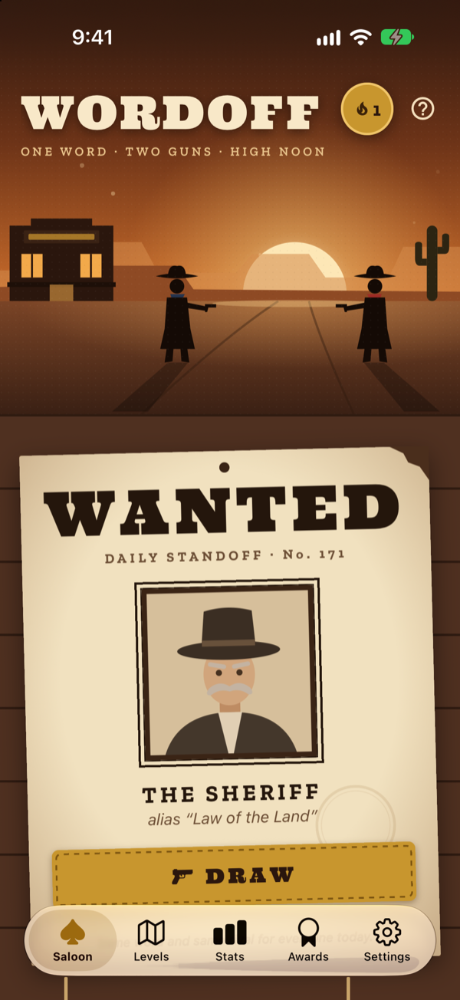
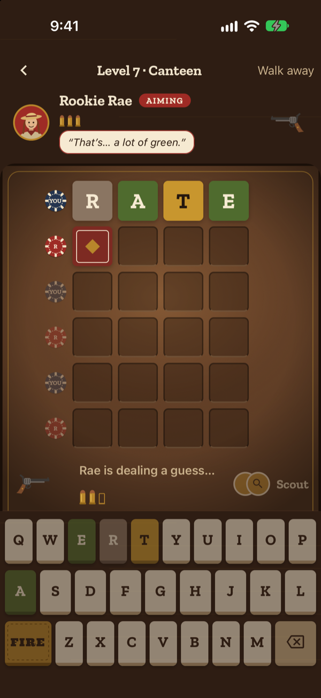
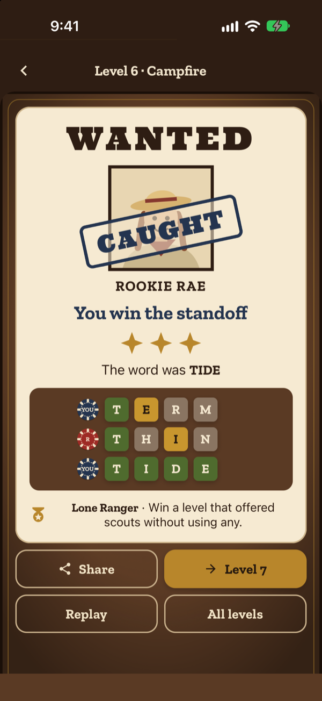
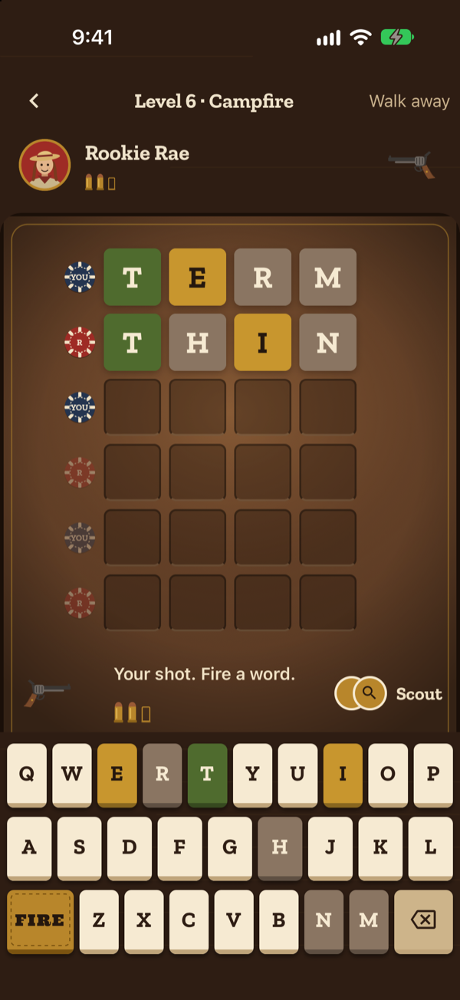
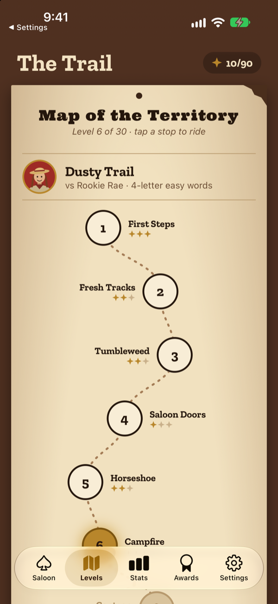
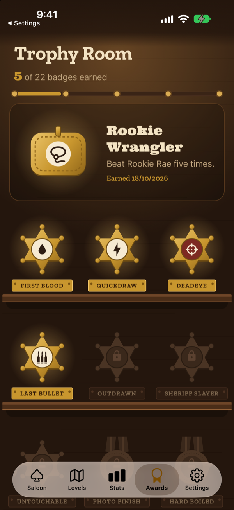
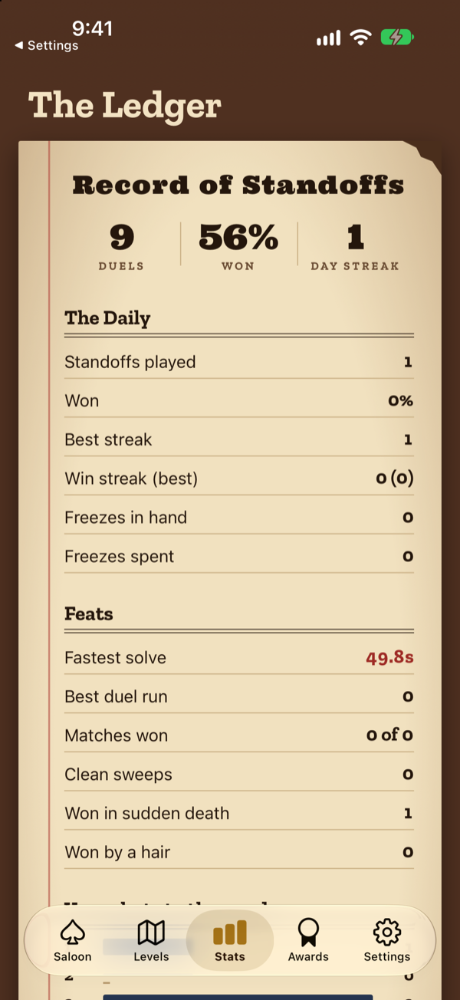
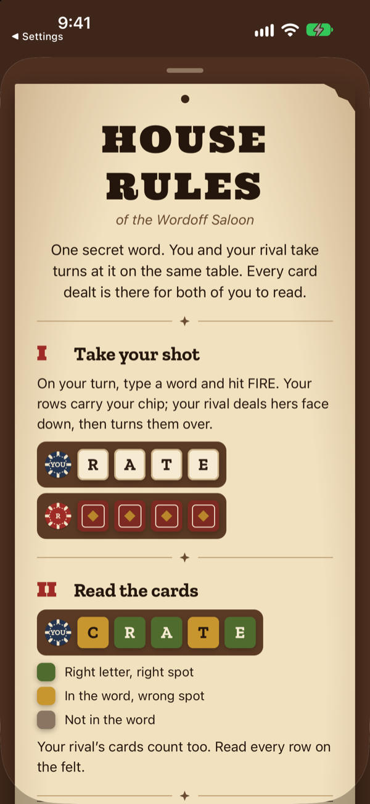
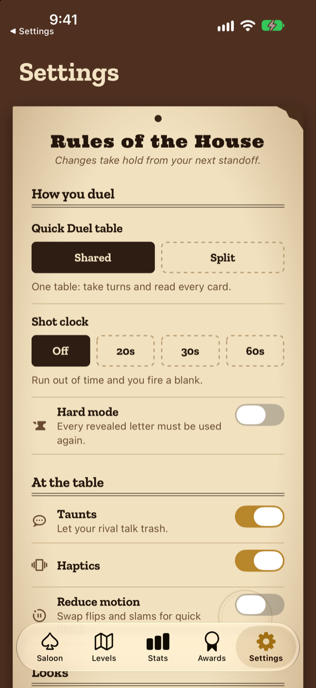

<p align="center">
  
</p>

<h1 align="center">Wordoff</h1>

<p align="center"><b>One word · Two guns · High noon</b></p>

<p align="center">
  A word game played as a duel. You and a rival chase the same secret word<br/>
  across one saloon table, and whoever lands it first wins.
</p>

<p align="center">
  <a href="https://github.com/oluwalonimioyepariola/wordoff/releases/latest/download/wordoff.apk"><b>⬇ Download for Android (APK)</b></a>
</p>

<p align="center">
  <a href="https://oluwalonimioyepariola.github.io/wordoff/"><b>Landing page</b></a> ·
  <a href="#play-it">Play it</a> ·
  <a href="#screens">Screens</a> ·
  <a href="DESIGN.md">Design system</a>
</p>

<p align="center">
  
  &nbsp;
  
  &nbsp;
  
</p>

---

## How a duel plays

1. **Take your shot.** Type a word and hit **FIRE**. Your rival answers on the same table, dealing her guess face down before she turns it over.
2. **Read the cards.** Green is the right letter in the right spot, gold is in the word but somewhere else, taupe isn't in the word. Her cards help you as much as your own.
3. **Land it first.** Turn over the whole word before she does. If the table fills up, sudden death reveals one letter and you each get one last shot.

The **Daily Standoff** uses classic standoff rules instead: separate tables, both fire at once, **3 · 2 · 1 · DRAW!** Everyone gets the same word and the same rival game that day, so share cards compare fairly.

## The rivals

| | Rival | Plays like |
|:-:|---|---|
| ✦ | **Rookie Rae**, *the Greenhorn* | Keeps her greens and skips the grays, but can't work out where yellows go. Your first ten levels, with 4-letter words. |
| ✦✦ | **Dusty Vance**, *the Gunslinger* | Reads every clue more often than not and trusts his gut over the maths. |
| ✦✦✦ | **The Sheriff**, *Law of the Land* | Picks whichever guess narrows the field the most. Fast, cold, almost never wrong. |

Every rival plays fair: they only ever learn from the cards on the table, never from the answer.

## Screens

Real screenshots from the working prototype in the iOS Simulator.

<table>
  <tr>
    <td align="center"><br/><b>Main Street</b><br/><sub>today's Daily Standoff</sub></td>
    <td align="center"><br/><b>The table</b><br/><sub>take turns, read every card</sub></td>
    <td align="center"><br/><b>Rival's turn</b><br/><sub>cards dealt face down</sub></td>
  </tr>
  <tr>
    <td align="center"><br/><b>The verdict</b><br/><sub>stamped and shareable</sub></td>
    <td align="center"><br/><b>The Trail</b><br/><sub>30 levels, three chapters</sub></td>
    <td align="center"><br/><b>Trophy Room</b><br/><sub>22 badges to earn</sub></td>
  </tr>
  <tr>
    <td align="center"><br/><b>The Ledger</b><br/><sub>every standoff on record</sub></td>
    <td align="center"><br/><b>House Rules</b><br/><sub>learn it in a minute</sub></td>
    <td align="center"><br/><b>Rules of the House</b><br/><sub>shot clock, hard mode, more</sub></td>
  </tr>
</table>

## What's in it

- **Daily Standoff.** One word a day based on the local date, the same rival game for everyone, one attempt, saved every round so it can't be re-rolled.
- **Level mode.** 30 levels in three chapters: easy 4-letter words against Rae, then 5-letter words against Dusty and the Sheriff. Stars, unlocks and scouts, tuned against a simulated player.
- **Quick Duel.** Unlimited duels, 4 or 5 letters, single or best of 3 and 5, on a shared or split table.
- **Scouts.** Reveal one letter when you're stuck, for a 10-second penalty that only matters in a dead-even finish.
- **Streaks and freezes.** A daily streak, a win streak, and a freeze every 7 days that covers a missed day.
- **Shot clock and hard mode.** Optional 20, 30 or 60-second timer; hard mode makes you reuse every revealed letter.
- **Ledger, trophy room and history.** Win rates, shot distribution, head-to-head records, 22 badges, and a stamped calendar of past Dailies.
- **Share card.** A spoiler-free emoji grid of the whole duel.
- **Feel.** Cards turning over, revolver recoil and ammo, the DRAW! slam, taunts, haptics.
- **Accessibility.** Follows the phone's light/dark mode, colourblind cards, reduced motion, labelled cards for screen readers.
- **Fully offline.** No account, no server, no ads. Everything lives on the device.

## Play it

**Android:** download [`wordoff.apk`](https://github.com/oluwalonimioyepariola/wordoff/releases/latest/download/wordoff.apk) from the [latest release](https://github.com/oluwalonimioyepariola/wordoff/releases/latest) and open it on your phone. The first time, Android asks you to allow installs from your browser or files app.

**iPhone or from source:** Wordoff isn't in the app stores yet. Run it with the free **Expo Go** app:

```bash
git clone https://github.com/oluwalonimioyepariola/wordoff
cd wordoff
npm install
npm start          # scan the QR code with Expo Go
```

Or open it in the iOS Simulator:

```bash
npm run ios
```

## Development

```bash
npm test             # engine tests (node:test via tsx)
npm run typecheck
npm run build:words  # regenerate word lists from scripts/answers*.txt
node scripts/build-brand.mjs   # regenerate the logo and app icons
```

Android builds run on [EAS Build](https://docs.expo.dev/build/introduction/):

```bash
npx eas-cli build -p android --profile preview   # installable APK
npx eas-cli build -p android --profile production   # Play Store bundle
```

| Path | What lives there |
|---|---|
| `src/engine/` | All game logic in pure TypeScript: scoring, daily word, duel rules (shared and split tables), AI rivals, levels, stats, streaks, badges, share card. Fully tested. |
| `src/game/` | Sequences a duel on screen: rival aiming, countdown, reveals, shot clock, taunts. |
| `src/app/` | Expo Router screens (tab bar: Saloon, Levels, Stats, Awards, Settings). |
| `src/components/`, `src/art/` | Cards, table, keyboard, motion, and all the vector art: scene, portraits, badges. |
| `web/` | The landing page: Next.js + Tailwind, exported statically and deployed to GitHub Pages. |
| `brand/` | The logo, generated by `scripts/build-brand.mjs`. |
| `DESIGN.md` | The Saloon Card Table design system. |

Built with React Native, Expo SDK 58, Expo Router, Reanimated and react-native-svg.
